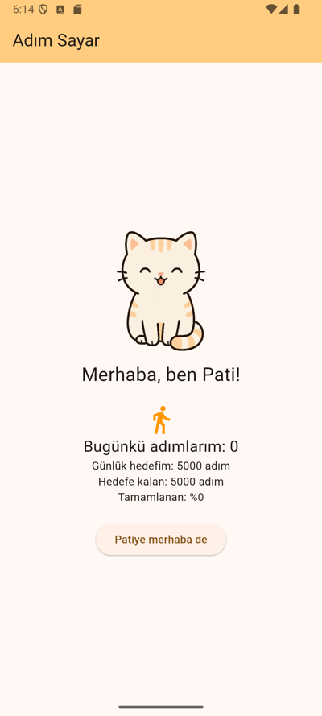
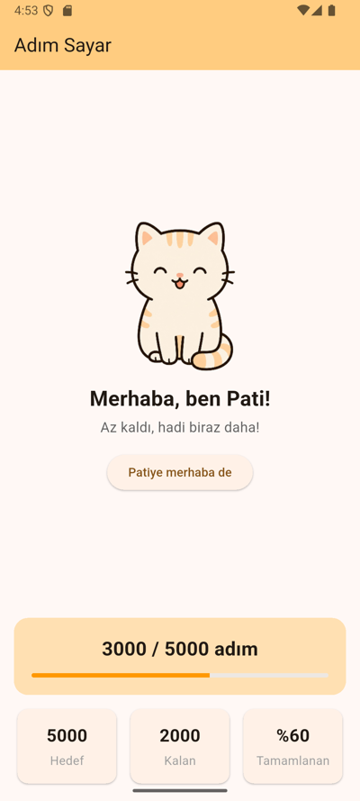

Hazırlayanlar: Elif Feyza Güneş, Yusuf Tarlak

Adım Sayar, BLM4587 iOS ile Mobil Uygulama Geliştirme I dersi için Flutter ile geliştirdiğimiz dönem projesi. Uygulamada kullanıcı günlük adımlarını sevimli bir kediyle birlikte takip edecek. Adım sayma, kullanıcı girişi ve Web API bağlantısı sonraki haftalarda eklenecek.

## Hafta 1

Uygulamanın ilk ekranını hazırladık. Kedi görseli, bugünkü adım sayısı, günlük hedef, kalan adım ve tamamlanma yüzdesi ekranda sabit değerlerle gösteriliyor.

## Hafta 2

Ekranın yerleşimini düzenledik. Adım bilgisi ince bir barla birlikte bir kartta, hedef, kalan ve tamamlanan değerleri de altta yan yana duruyor. Kedinin görseli ve mesajı tamamlanan yüzdeye göre değişiyor.

