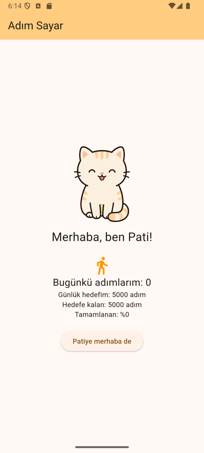
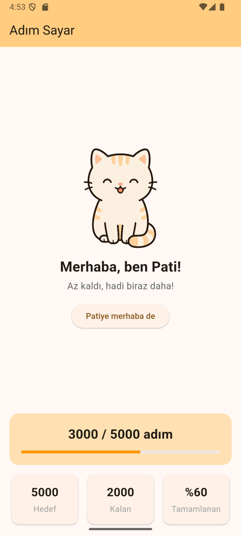
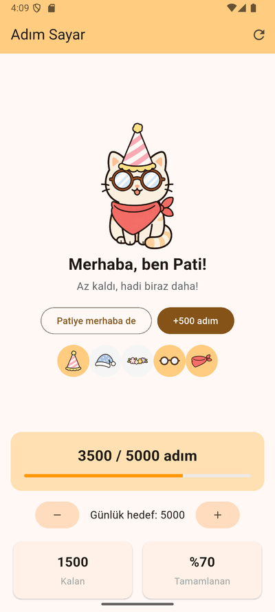

Hazırlayanlar: Elif Feyza Güneş, Yusuf Tarlak

Adım Sayar, BLM4587 iOS ile Mobil Uygulama Geliştirme I dersi için Flutter ile geliştirdiğimiz dönem projesi. Uygulamada kullanıcı günlük adımlarını sevimli bir kediyle birlikte takip edecek. Adım sayma, kullanıcı girişi sonraki haftalarda eklenecek.

## Hafta 1

Uygulamanın ilk ekranını hazırladık. Kedi görseli, bugünkü adım sayısı, günlük hedef, kalan adım ve tamamlanma yüzdesi ekranda sabit değerlerle gösteriliyor.

## Hafta 2

Ekranın yerleşimini düzenledik. Adım bilgisi ince bir barla birlikte bir kartta, hedef, kalan ve tamamlanan değerleri de altta yan yana duruyor. Kedinin görseli ve mesajı tamamlanan yüzdeye göre değişiyor.

## Hafta 3

Ana sayfayı StatefulWidget yaptık, artık ekrandaki değerler butonlarla değişiyor. Günlük hedef - ve + butonlarıyla 500'er adım değiştirilebiliyor, +500 adım butonuyla adım eklenebiliyor ve kedi buna göre değişiyor. Hedefe ulaşınca ve hedef 1000'in altına indirilmek istenince SnackBar ile mesaj çıkıyor, adımlar sıfırlanmadan önce onay soruluyor.

Kedimize aksesuar takma ekledik. Baş, yüz ve boyun için ayrı aksesuarlar var, aynı bölgeden yenisi seçilince eskisi çıkıyor ve aksesuarlar Stack ile kedinin üstünde gösteriliyor.

Ayrıca api klasöründe Node.js ve Express ile Web API projesini kurduk. Şimdilik aksesuar listesini ve tek bir aksesuarı döndüren uç noktalar var, aksesuar görselleri de API üzerinden açılabiliyor. Veritabanı bağlantısı gelecek hafta eklenecek.

